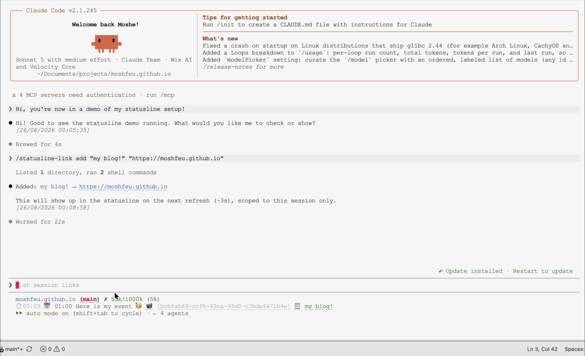

## Background

Claude Code already ships with a <a href="https://code.claude.com/docs/en/statusline#set-up-a-status-line" target="_blank">status line feature</a> that covers the basics: current directory, Git branch, and context window usage. That part is documented and easy to set up on its own.

The status line is valuable space. Once I discovered how easy it is to customize, I adjusted it to show everything I need in a style that works for me. Here is what I adjusted and added:

- Clickable Git branch that opens the current project **and worktree** in my editor
- A clock, since I run Superset in full screen and want to see the time without leaving the terminal
- The next Google Calendar meeting, including its time, room number, and conference link
- Clickable session ID that opens the current session in <a href="https://www.agentsview.io/" target="_blank">AgentsView</a>
- Useful links attached to a session, such as the Grafana dashboard or the internal company Canvas URL I am working on

## A quick reminder about status line configuration

```json
// ~/.claude/settings.json
{
  "statusLine": {
    "type": "command",
    "command": "sh /path/to/.claude/statusline-command.sh",
  }
}
```

The `statusLine.command` script is run every minute by default, and its output is used to render the status line. The script can be any shell script, and it can use any tools available in the environment.

## Clickable Git branch

In a normal terminal, the branch can be a link to the current project using your editor's URI scheme, such as `cursor://path/to/project`.

_statusline-command.sh_

```bash
#!/bin/sh
branch_url="<ide-scheme>://file${cwd}"
branch_text=$(printf "${blue_bold}(${red}%s${blue_bold})${reset}" "$git_branch")
branch_link="\033]8;;${branch_url}\033\\${branch_text}\033]8;;\033\\"
output="${output} ${branch_link}"
```

_`ide-scheme` (for example, `cursor` for the Cursor editor)_

In Superset.sh, custom schemes are not supported, so I use a local HTTP server started by the status line script. I may share that code in a separate post.

### Clock

```bash
clock=$(date +%H:%M)
output="${output} ⏱️ ${clock}"
```

### Next meeting

The calendar widget shows the next meeting only when it is close enough to be useful. The status line can refresh every few seconds, so calling the calendar API during every render would make it slow and unreliable. Instead, a separate refresh script writes the next event to a local JSON cache, and the status line reads that cache.

_gcal-status.sh_

```bash
CACHE_FILE="$HOME/.claude/.gcal-status-cache.json"
REFRESH_SCRIPT="$HOME/.claude/gcal-status-refresh.py"
REFRESH_INTERVAL=300

cache_age=999999
if [ -f "$CACHE_FILE" ]; then
  cache_mtime=$(stat -f %m "$CACHE_FILE" 2>/dev/null || stat -c %Y "$CACHE_FILE" 2>/dev/null)
  [ -n "$cache_mtime" ] && cache_age=$(($(date +%s) - cache_mtime))
fi

if [ "$cache_age" -ge "$REFRESH_INTERVAL" ]; then
  (python3 "$REFRESH_SCRIPT"; rm -f "$HOME/.claude/.gcal-status-refresh.lock") \
    >/dev/null 2>&1 &
fi
```

The refresh script uses a CLI to access the Google Calendar API. The details are outside the scope of this post. It fetches the next event and writes it to the cache file in the background, so the status line can continue to render without waiting for the API call to complete.

```python
if start <= now < end:
    print(f"{green}📅 In: {summary} (ends {end.astimezone().strftime('%H:%M')}){reset}")
else:
    mins_until = (start - now).total_seconds() / 60
    if mins_until > 120:
        sys.exit(0)
    if mins_until <= red_minutes:
        room_name = room(event.get("location"))
        room_part = f" {room_name}" if room_name else ""
        print(f"{red}📅 {summary} in {max(0, int(mins_until))}m{room_part}{reset}")
```

## A session ID that opens the session

Claude Code sessions already have an ID. As much as I like Claude Code, I sometimes prefer a better reading UI, so I use <a href="https://www.agentsview.io/" target="_blank">AgentsView</a> for that. I wanted to be able to click the session ID in the status line to open it in AgentsView.

The link uses the following AgentsView URL format: `http://localhost:8080/sessions/<session-id>`.

```bash
if [ -n "$session_id" ]; then
  url="http://localhost:8080/sessions/${session_id}"
  link="\033]8;;${url}\033\\$(printf "${dim}[%s]${reset}" "$session_id")\033]8;;\033\\"
  output="${output} ${link}"
fi
```

Since I need to refresh the session from time to time, refresh the `/mcp` list, apply updates, or recover when Claude Code gets stuck or becomes corrupted, the next part of the widget is a "copy resume command" link that uses the same local server as the branch link:

```bash
resume_cmd="claude --resume ${session_id}"
resume_cmd_enc=$(printf '%s' "$resume_cmd" | jq -sRr '@uri')
copy_url="http://127.0.0.1:${open_editor_port}/copy?token=${open_editor_token}&text=${resume_cmd_enc}"
copy_link="\033]8;;${copy_url}\033\\📋\033]8;;\033\\"
```

Now the status line shows a small clipboard icon next to the session ID. Clicking it copies `claude --resume <session-id>` to the clipboard, ready to paste into any terminal.

## Useful links attached to a session

Similar to Claude Code's Canvas URL feature, I wanted to attach arbitrary links to a session, such as a Grafana dashboard, a Canvas file (not Claude's), or a local file I keep coming back to. Rather than scrolling up and down to find them, I can pin them in the status line.

This can follow a shared pattern, where a URL mentioned in the chat is added automatically, or it can be ad hoc: "add this link to the status line." If a CLI command produces a shareable URL, a hook saves it to a per-session file.

_~/.claude/settings.json_

```json
{
  "PostToolUse": [
    {
      "matcher": "Bash",
      "hooks": [
        {
          "type": "command",
          "command": "sh \"/path/to/.claude/hooks/capture-preview-link.sh\""
        }
      ]
    },
  ]
}
```

`capture-preview-link.sh` is a simple script that checks whether the last tool output was a URL in a specific format and, if so, saves it to `~/.claude/state/preview-links/<session-id>`.

The status line script checks for that file and adds a small link to the status line if it exists:

```bash
if [ -n "$session_id" ]; then
  preview_link_file="$HOME/.claude/state/preview-links/${session_id}"
  if [ -f "$preview_link_file" ]; then
    preview_url=$(cat "$preview_link_file")
    preview_text=$(printf "${green}📦 preview${reset}")
    preview_link="\033]8;;${preview_url}\033\\${preview_text}\033]8;;\033\\"
    output="${output} ${preview_link}"
  fi
fi
```

The second case is manual: a per-session links file where I can add any label and target I want mid-conversation:

```bash
if [ -n "$session_id" ]; then
  session_links_file="$HOME/.claude/state/session-links/${session_id}"
  if [ -f "$session_links_file" ]; then
    while IFS="$(printf '\t')" read -r link_label link_target; do
      [ -n "$link_label" ] || continue
      case "$link_target" in
        http://*|https://*) link_url="$link_target" ;;
        *)
          link_target_enc=$(printf '%s' "$link_target" | jq -sRr '@uri')
          link_url="http://127.0.0.1:${open_editor_port}/open?token=${open_editor_token}&path=${link_target_enc}"
          ;;
      esac
      link_text=$(printf "${green}%s${reset}" "$link_label")
      session_link="\033]8;;${link_url}\033\\${link_text}\033]8;;\033\\"
      output="${output} ${session_link}"
    done < "$session_links_file"
  fi
fi
```

The session links file is a simple text file with one link per line, in the format:

```txt
🧩 Dashboard JSON       ~/path/to/grafana-file.json
```

Each line in `~/.claude/state/session-links/<session_id>` is a tab-separated `LABEL<TAB>target`. A target can be an `http(s)` URL, shown as-is, or a local absolute path, which is opened through the same local editor server used for the branch link.

I do not want to edit that file by hand in the middle of a conversation, so I added a small slash command to manage it:

```bash
/statusline-link add "<label>" <target>
/statusline-link remove "<label>"
/statusline-link list
```

The `add` command resolves the current session ID, validates the target, and appends a `LABEL<TAB>TARGET` line to the session file. If the same label already exists, it replaces it instead of duplicating it. `remove` deletes the line by label, and `list` prints the current links for the session.

Since the status line refreshes every few seconds, a link added this way shows up almost immediately without touching config files directly.

## Cache

The cache is important for keeping the status line fast and reliable. See the <a href="https://code.claude.com/docs/en/statusline#cache-expensive-operations" target="_blank">Claude Code documentation about caching expensive operations</a> for details.

## The result


